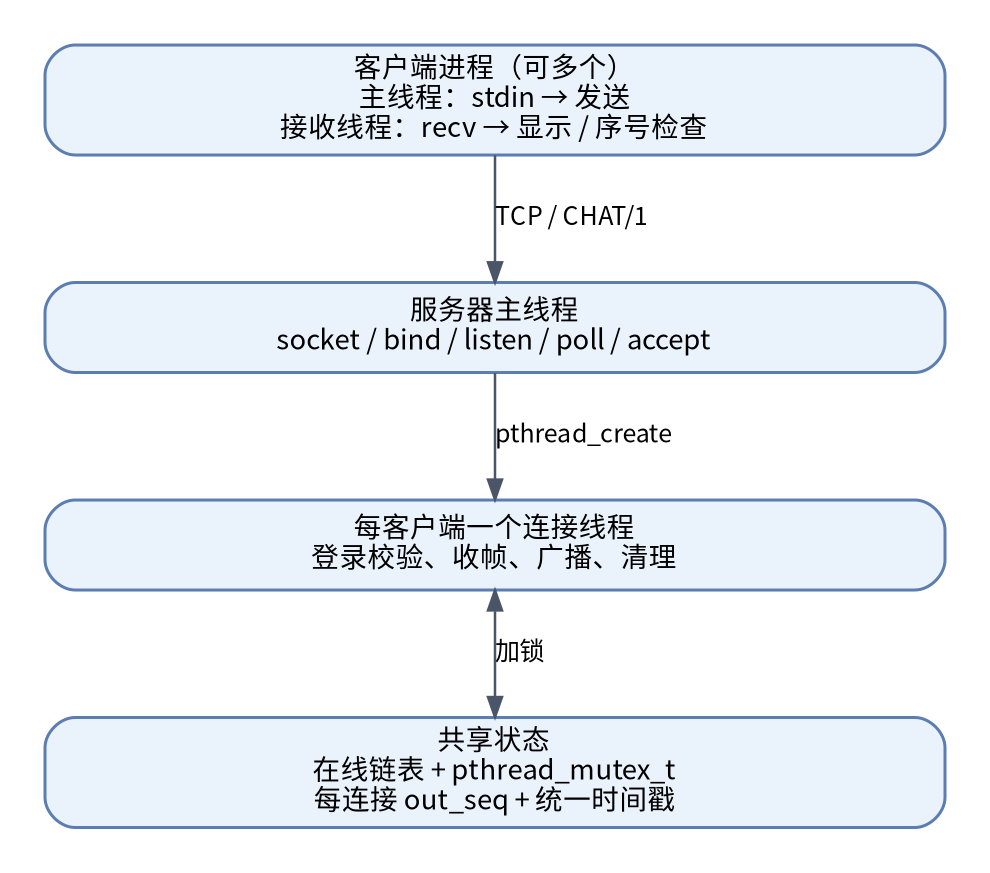
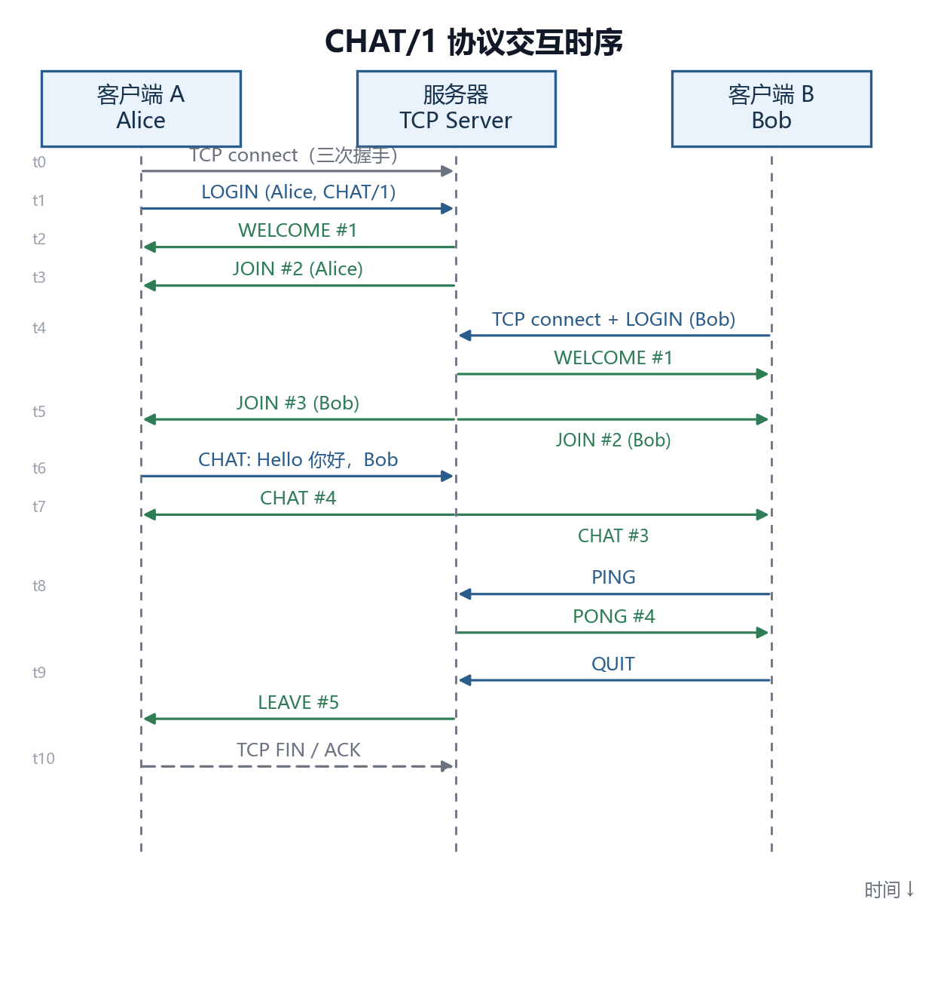
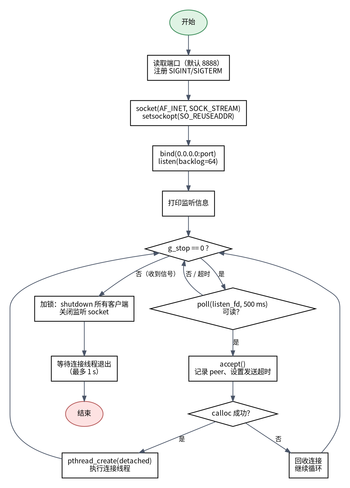
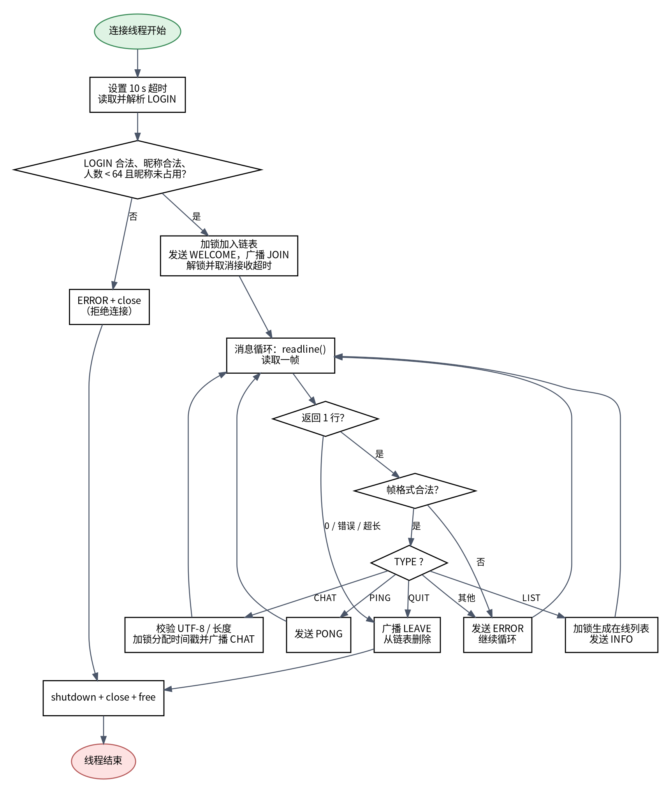
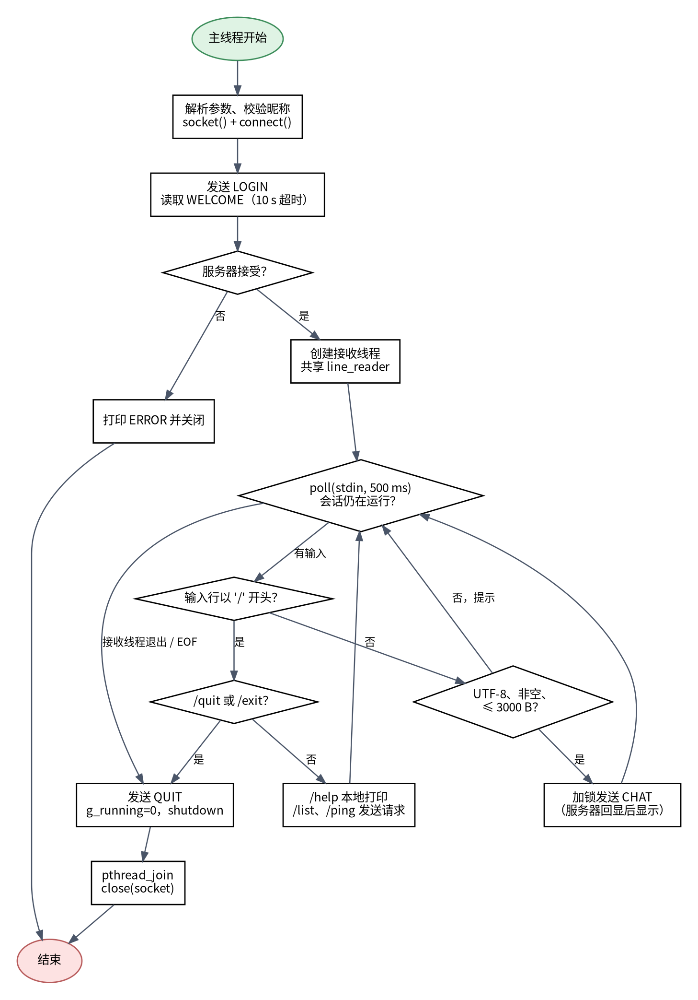
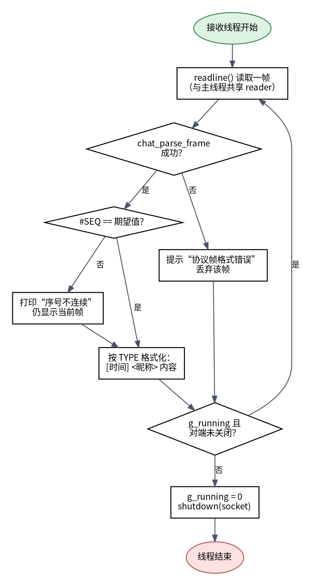

# 摘要

本实验使用 C 语言和基本 Socket 函数设计并实现了一个基于 TCP 流式套接字的多用户命令行聊天程序。程序自定义 `CHAT/1` 应用层协议，采用 `TYPE|SEQ|TIME|FROM|BODY` 的行帧格式，由服务器为每条聊天消息生成统一时间戳，并为每个“服务器→客户端”连接维护独立的递增序号。服务器采用“主线程 `poll`/`accept` + 每连接一个 `pthread`”的并发模型，客户端采用输入主线程与接收线程分离的结构。程序支持 UTF-8 中英文、中文昵称、登录超时、昵称唯一性、断线清理、在线列表和 PING/PONG。

在 Ubuntu 24.04（WSL2）环境中，使用三个真实客户端进程完成了中文、英文、混合文本、管道符和 Emoji 的广播测试；每个客户端收到的服务器帧序号均从 1 连续递增，重复昵称被服务器拒绝。使用 tcpdump/tshark 观察回环链路：正常运行时 57 个 TCP 帧中重传、缺段和 RST 均为 0；使用 `tc netem` 模拟 15% 丢包时，95 个帧中出现 8 个 TCP 重传/缺段标记，但应用层序号仍连续，说明 TCP 恢复了网络层丢包，聊天消息没有在应用层丢失。

**关键词：** TCP；流式套接字；多线程；聊天协议；UTF-8；丢包观察

<!-- pagebreak -->
<!-- toc -->
<!-- pagebreak -->

# 1 实验目的与要求

本实验围绕“流式 Socket 编程 + 自定义应用层协议 + 多线程并发”展开，目标是完成一个可实际运行的多用户聊天系统，并观察 TCP 在丢包环境下的行为。具体要求及完成情况如下：

1. 使用流式 Socket 设计聊天协议，聊天信息带时间，完整说明消息语法、语义和时序。
2. 设计聊天程序，给出模块划分、模块功能和流程图。
3. 使用 C/C++ 和基本 Socket 函数实现，不使用封装后的 Socket 类或网络框架。
4. 支持英文和中文聊天。
5. 采用多线程，支持多人同时聊天。
6. 程序结构清晰、可读性良好。
7. 观察是否有数据包丢失。
8. 撰写实验报告，并将报告与源码上传至 GitHub。

# 2 实验环境

| 项目 | 配置 |
|---|---|
| 主机系统 | Windows 11 Home China，版本 10.0.26200 |
| 运行环境 | WSL2，Ubuntu 24.04 LTS，Linux 6.6.87.2-microsoft-standard-WSL2 |
| 编译器 | GCC 13.3.0，C11，`-Wall -Wextra -Wpedantic` |
| 构建工具 | GNU Make 4.3 |
| 并发库 | POSIX Threads（pthread） |
| 抓包工具 | tcpdump 4.99.4，tshark 4.2.2 |
| 丢包模拟 | Linux `tc` + `netem`（回环接口） |
| 测试脚本 | Python 3（仅用于自动化测试，不参与程序实现） |
| 实验日期 | 2026-10-28 |

程序使用 POSIX Socket 和 pthread，在 Linux/WSL 下编译运行；Windows 原生环境不直接支持本实验使用的 pthread 接口。

# 3 系统总体设计

## 3.1 总体架构

系统由聊天服务器和若干聊天客户端组成，二者通过 TCP 连接交换 UTF-8 文本帧。服务器主线程只负责监听和接受连接；每个客户端连接由一个独立线程服务。所有在线客户端的连接信息保存在一个共享链表中，由互斥锁保护。



**图 1 系统总体架构**

客户端包含两个线程：主线程读取终端输入并发送消息，接收线程持续读取服务器帧并格式化显示。服务器包含一个主线程和 N 个连接线程；连接线程负责登录校验、消息解析、广播和清理。

## 3.2 模块划分

| 模块 | 文件 | 主要功能 |
|---|---|---|
| 协议模块 | `include/chat_protocol.h`、`src/chat_protocol.c` | 帧构造与解析、时间戳、UTF-8 校验、昵称/正文规则 |
| 网络工具模块 | `include/net_util.h`、`src/net_util.c` | `tcp_listen`、`tcp_connect`、`send_all`、`reader_readline`、超时与 keepalive |
| 服务器模块 | `src/server.c` | 监听、接受连接、登录校验、在线链表、广播、信号处理 |
| 客户端模块 | `src/client.c` | 连接、登录、键盘输入、接收线程、命令处理、序号检查 |
| 测试模块 | `tests/`、`scripts/` | 协议单元测试、三客户端集成测试、抓包与丢包模拟 |

模块之间通过明确的头文件接口通信，协议模块不依赖网络模块，网络模块不包含聊天业务逻辑，便于单独测试协议编解码和 UTF-8 校验。

## 3.3 并发与同步设计

服务器使用 `pthread_mutex_t` 保护在线链表、在线人数、昵称唯一性检查和所有发送操作。一次广播在锁内完成：服务器先为事件生成统一时间戳，再为每个接收连接分配其下一个序号并发送。这样既保证昵称检查与加入链表的原子性，也保证所有客户端观察到一致的广播顺序。

客户端接收线程只负责 `recv`、解析和显示；主线程只负责读取 stdin 和发送。`g_send_lock` 串行化发送，`g_print_lock` 保护标准输出。接收线程与主线程共享同一个行读取器，避免登录阶段预读到缓冲区中的 `JOIN` 帧被丢弃。

# 4 聊天协议设计

## 4.1 传输层、编码和分帧

协议运行在 TCP 之上，默认端口 8888。TCP 是字节流，不保留消息边界，因此应用层必须自行分帧。`CHAT/1` 采用“一行一帧、LF 结尾”的文本帧，字符编码为 UTF-8（无 BOM），单帧最大 4096 字节（含换行）。

```abnf
frame   = type "|" seq "|" time "|" from "|" body LF
type    = 1*15(%x41-5A)              ; 大写字母
seq     = %x31-39 *DIGIT             ; 正整数
time    = 4DIGIT "-" 2DIGIT "-" 2DIGIT SP
          2DIGIT ":" 2DIGIT ":" 2DIGIT
from    = nickname / "server"
body    = *3000(UTF8-char)           ; 可含 "|"
```

| 字段 | 语义 | 约束 |
|---|---|---|
| `TYPE` | 消息类型 | 1–15 个大写字母 |
| `SEQ` | 序列号 | 正整数，服务器→客户端方向按连接独立递增 |
| `TIME` | 时间 | `YYYY-MM-DD HH:MM:SS`，服务器本地时间 |
| `FROM` | 发送者 | `server` 或登录昵称；聊天消息中由服务器填写 |
| `BODY` | 正文 | ≤3000 个 UTF-8 字节，不能含 CR/LF 和控制字符 |

解析时只把前 4 个 `|` 作为分隔符，第 5 段整体作为 `BODY`。因此聊天内容可以包含 `|`，例如 `CHAT|4|2026-10-28 20:19:44|Alice|a|b|c` 的正文是 `a|b|c`。昵称禁止包含 `|`、空格和控制字符。

读取端使用带缓冲的行读取器：每次 `recv()` 的字节追加到缓冲区，找到 LF 才返回一帧；一次读取到多条帧时，剩余字节留给下一次解析。这解决了 TCP 的拆包和粘包问题。

## 4.2 时间与序号语义

**时间。** 服务器在广播前调用 `chat_now()` 生成时间，使用 `localtime_r` 和 `strftime("%Y-%m-%d %H:%M:%S")`。同一次广播的所有接收者共享同一个时间戳。客户端 `LOGIN`/`PING` 中的时间只用于调试记录，聊天消息显示的时间一律来自服务器，避免各客户端时钟不一致。

**序号。** 服务器为每个客户端连接维护独立的 `out_seq`，从 1 开始；`WELCOME`、`JOIN`、`LEAVE`、`CHAT`、`PONG`、`INFO`、`ERROR` 每一帧都使用该连接的下一个序号。客户端保存 `expected_seq`，收到帧后检查 `SEQ` 是否等于期望值；不一致时打印“序号不连续，疑似丢失或乱序”。由于序号按接收连接独立编号，同一次广播在不同客户端看到的序号可能不同，这是正常的。

客户端发往服务器的帧也有本地递增序号，但服务器不信任客户端提供的 `SEQ`、`TIME` 和 `FROM`：聊天发送者由连接登录时保存的昵称决定，时间由服务器重新生成。这样既防止简单伪造，也使序号语义清晰。

## 4.3 消息类型及语义

| 类型 | 方向 | BODY | 语义 |
|---|---|---|---|
| `LOGIN` | C→S | `CHAT/1` | 首帧，声明昵称和协议版本，`FROM` 为请求昵称 |
| `WELCOME` | S→C | 欢迎语、在线人数 | 登录成功，该连接 `SEQ=1` |
| `CHAT` | C→S | 聊天正文 | 请求广播；服务器校验后重新生成 `SEQ/TIME/FROM` |
| `CHAT` | S→all | 聊天正文 | 广播给包括发送者在线的所有客户端 |
| `JOIN` | S→all | 加入提示 | 新用户上线 |
| `LEAVE` | S→all | 离开提示 | 主动退出、断线或服务器关闭 |
| `PING` | C→S | 空或短文本 | 应用层探活 |
| `PONG` | S→C | `pong` | 对 PING 的响应 |
| `LIST` | C→S | 空 | 请求在线用户列表 |
| `INFO` | S→C | `在线用户（N）：…` | 返回在线昵称 |
| `QUIT` | C→S | 空 | 主动退出 |
| `ERROR` | S→C | `CODE: 说明` | 协议或业务错误 |

登录前的错误直接返回 `ERROR` 并关闭；登录后的格式错误、非法正文和未知类型返回 `ERROR` 后保持连接；超长帧则关闭连接。主要错误码包括 `LOGIN_TIMEOUT`、`BAD_LOGIN`、`BAD_NICKNAME`、`NICK_TAKEN`、`SERVER_FULL`、`FRAME_TOO_LONG`、`BAD_FRAME`、`BAD_TEXT`、`UNKNOWN_TYPE` 和 `SERVER_STOPPING`。

## 4.4 交互时序

正常登录和聊天的时序如下：

1. 客户端建立 TCP 连接，立即发送 `LOGIN|1|客户端时间|昵称|CHAT/1`。
2. 服务器设置 10 秒登录超时，读取并校验首帧，检查昵称合法性和唯一性、在线人数是否小于 64。
3. 服务器加锁，将客户端加入链表，发送 `WELCOME`（该连接 `SEQ=1`），并向所有在线客户端广播 `JOIN`（新客户端为 `SEQ=2`）；随后解锁。
4. 客户端收到 `WELCOME` 后启动接收线程，进入聊天状态；服务器取消登录超时，进入消息循环。
5. 用户输入普通文本时，客户端发送 `CHAT`。服务器忽略客户端的 `SEQ/TIME/FROM`，校验正文后在锁内生成服务器时间、为每个接收者分配序号并广播，发送者也会收到回显。
6. 用户输入 `/ping` 时发送 `PING`，服务器返回 `PONG`；`/list` 返回 `INFO`。
7. 用户输入 `/quit` 或输入 EOF 时，客户端发送 `QUIT`/关闭连接；服务器读到 `QUIT` 或 EOF 后广播 `LEAVE`、从链表删除并关闭 fd。



**图 2 协议交互时序（序号按每个接收连接独立编号，完整字段语法见 4.1 节）**

以 Alice 和 Bob 为例，Alice 的连接可能看到 `WELCOME #1、JOIN #2、JOIN Bob #3、CHAT #4`，而 Bob 的连接看到 `WELCOME #1、JOIN Bob #2、CHAT #3`。这是因为序号是“每个服务器→客户端连接”独立的，不是全局消息编号。

## 4.5 中文与 UTF-8

协议层按字节寻找 `|` 和 `\n`，这两个字节不会出现在 UTF-8 多字节字符内部，因此中文不会破坏分帧。程序严格检查 UTF-8：拒绝过长编码、非法续字节、UTF-16 代理区、超过 U+10FFFF 的码点，以及 C0/C1 控制字符。昵称按 Unicode 码点限制为 1–16 个字符，正文按 UTF-8 字节限制为 3000 字节。服务器和客户端都不做编码转换，终端需使用 UTF-8。

# 5 模块功能与流程图

## 5.1 服务器主线程

服务器主线程解析端口，创建监听 socket，设置 `SO_REUSEADDR`，执行 `bind` 和 `listen`；随后以 500 ms 超时 `poll` 监听 fd，在可读时 `accept`，为每个连接分配 `client_t` 并创建 detached 连接线程。收到 `SIGINT/SIGTERM` 时退出循环，加锁 `shutdown` 所有客户端，关闭监听 fd，并等待连接线程退出（最多 1 秒）。



**图 3 服务器主线程流程图**

## 5.2 服务器连接线程

每个连接线程先读取首帧，验证 `LOGIN` 类型、协议版本、昵称格式、昵称唯一性和容量。成功后加入在线链表、发送 `WELCOME`、广播 `JOIN`，进入消息循环。循环中处理 `CHAT`、`PING`、`LIST`、`QUIT`；遇到 EOF、错误或超长帧时退出循环，广播 `LEAVE`、从链表删除、`shutdown`/`close` 并释放内存。



**图 4 服务器连接线程流程图**

## 5.3 客户端主线程

客户端主线程解析命令行参数并本地校验昵称，连接服务器后发送 `LOGIN`，等待 `WELCOME`；失败则打印错误并关闭。成功后创建接收线程，进入 `poll(stdin, 500 ms)` 循环：`/help` 本地处理，`/list`、`/ping` 发送请求，普通文本经 UTF-8 和长度校验后发送 `CHAT`；`/quit` 或 EOF 时发送 `QUIT`、`shutdown`，等待接收线程结束并关闭 socket。



**图 5 客户端主线程流程图**

## 5.4 客户端接收线程

接收线程循环调用 `readline()`，解析服务器帧，检查 `SEQ` 是否连续，再按类型格式化显示。服务器关闭或读错误时设置 `g_running=0` 并 `shutdown`，主线程在下一次轮询时退出。



**图 6 客户端接收线程流程图**

# 6 关键实现

## 6.1 基本 Socket 函数

程序直接使用 POSIX Socket API，没有使用任何 Socket 类或网络框架。核心调用如下：

| 函数 | 用途 |
|---|---|
| `socket(AF_INET/AF_UNSPEC, SOCK_STREAM, 0)` | 创建 TCP 套接字 |
| `setsockopt(SO_REUSEADDR/SO_RCVTIMEO/SO_SNDTIMEO/SO_KEEPALIVE)` | 地址复用、登录超时、发送超时、保活 |
| `bind`、`listen`、`accept` | 服务器监听与接受连接 |
| `connect` | 客户端连接服务器 |
| `send` / `recv` | 发送和接收字节流 |
| `shutdown`、`close` | 半关闭和释放 fd |
| `getaddrinfo` | 解析主机名/端口，支持 IPv4/IPv6 地址列表 |

`send_all()` 循环调用 `send()` 直到全部字节发出，处理短写和 `EINTR`；`reader_readline()` 在用户态缓冲 `recv()` 数据并按 LF 切帧，处理半包/粘包。

## 6.2 多线程与锁

服务器为每个连接创建一个 detached 线程：

```c
pthread_attr_setdetachstate(&attr, PTHREAD_CREATE_DETACHED);
pthread_create(&thread, &attr, client_thread, client);
```

在线链表和发送操作由同一把互斥锁保护。广播函数只在锁内被调用，逐个客户端 `send_all`，因此不会出现两条消息穿插到同一连接的情况。某个客户端发送失败时，`send_frame_locked()` 把它标记为 `active=0` 并 `shutdown`，其他客户端不受影响。

客户端主线程和接收线程共享 `line_reader_t`，但只有接收线程在登录后读取 socket；发送使用 `g_send_lock`，输出使用 `g_print_lock`。主线程用 `poll(stdin, 500 ms)` 而不是永久阻塞 `fgets`，所以服务器断开后进程也能及时结束。

## 6.3 时间戳与序号

服务器在广播前调用 `chat_now()`；`send_frame_locked()` 使用 `client->out_seq + 1` 构造帧，成功后更新 `out_seq`。客户端登录完成后把 `expected_seq` 设为 `WELCOME.seq + 1`，之后每收到一帧检查连续性。出现缺口时，客户端打印：

```text
[时间] [!] 序号不连续：收到 #N，期望 #M，疑似丢失或乱序
```

该检查是应用层观测手段；正常 TCP 连接下不应出现缺口。`-s` 选项会显示每一帧的 `#序号`，便于把运行日志与协议文档、抓包结果对应起来。

## 6.4 中文输入与显示

`chat_valid_utf8()` 对每个字节序列进行严格校验，`chat_valid_text()` 再检查非空、无控制字符和长度。服务器对每条 `CHAT` 正文独立校验，不依赖客户端。帧结构中的 `FROM` 字段在登录后由服务器保存的昵称填充，客户端无法通过修改 `CHAT` 帧来冒充他人。

## 6.5 命令行交互

```bash
./bin/chat_server 8888
./bin/chat_client 127.0.0.1 8888 Alice
./bin/chat_client -s 127.0.0.1 8888 小明
```

客户端命令包括 `/help`、`/list`、`/ping`、`/quit`；普通文本直接作为聊天内容发送。单条消息最多 3000 个 UTF-8 字节。

# 7 程序使用方法

## 7.1 编译

```bash
make
make test
```

`make` 生成 `bin/chat_server` 和 `bin/chat_client`；`make test` 运行协议单元测试和三客户端端到端测试。

## 7.2 运行

```bash
# 终端 1：服务器
./bin/chat_server 8888

# 终端 2、3、4：三个客户端
./bin/chat_client 127.0.0.1 8888 Alice
./bin/chat_client 127.0.0.1 8888 Bob
./bin/chat_client 127.0.0.1 8888 小明
```

在局域网其他机器上运行时，把 `127.0.0.1` 换成服务器 IP。服务器绑定 `0.0.0.0`，默认端口 8888；如果使用 WSL2，需要确认 Windows 防火墙和端口转发设置。

# 8 测试与结果

## 8.1 测试方法

测试分为三层：

1. **协议单元测试**：直接调用协议模块，覆盖帧往返、正文中的 `|`、非法序号、超长正文、中文/Emoji、非法 UTF-8、昵称规则等。
2. **端到端集成测试**：启动真实服务器和三个真实客户端（Alice、Bob、小明），发送中文、英文、混合文本、Emoji 和含 `|` 的正文，验证广播、`/ping`、`/list`、`/quit`、重复昵称拒绝，并解析每个客户端的 `-s` 日志确认序号连续。
3. **抓包观察**：在回环接口上用 tcpdump 抓取测试流量，用 tshark 统计 TCP 会话、重传、缺段和 RST；再用 `tc netem` 模拟丢包，观察 TCP 恢复行为。

## 8.2 单元测试结果

```text
$ make test-unit
protocol tests: all passed
```

单元测试覆盖了 `chat_make_frame` / `chat_parse_frame` 的正常和异常路径，以及 `chat_valid_utf8` 对非法 UTF-8 的拒绝。测试源码为 `tests/protocol_test.c`。

## 8.3 三客户端集成测试结果

集成测试的实际客户端日志如下（节选，完整日志见 `docs/samples/`）：

```text
=== 多用户聊天室 / Multi-user chat ===
server: 127.0.0.1:19001   nickname: Alice
[2026-10-28 20:21:37] #1 * 欢迎 Alice！输入 /help 查看命令。Welcome! Online users: 1
[2026-10-28 20:21:37] #2 * Alice 加入了聊天室（joined the chat）
[2026-10-28 20:21:39] #3 * Bob 加入了聊天室（joined the chat）
[2026-10-28 20:21:40] #4 * 小明 加入了聊天室（joined the chat）
[2026-10-28 20:21:41] #5 <Alice> 大家好，我是 Alice。Hello, this is Alice.
[2026-10-28 20:21:43] #6 <Bob> Hi Alice! 中英混合 mixed message 😀
[2026-10-28 20:21:45] #7 <小明> 三人都在：Hello 大家好 123，管道符 | 也可以发送。
```

```text
=== 多用户聊天室 / Multi-user chat ===
server: 127.0.0.1:19001   nickname: Bob
[2026-10-28 20:21:39] #1 * 欢迎 Bob！输入 /help 查看命令。Welcome! Online users: 2
[2026-10-28 20:21:39] #2 * Bob 加入了聊天室（joined the chat）
[2026-10-28 20:21:40] #3 * 小明 加入了聊天室（joined the chat）
[2026-10-28 20:21:41] #4 <Alice> 大家好，我是 Alice。Hello, this is Alice.
[2026-10-28 20:21:43] #5 <Bob> Hi Alice! 中英混合 mixed message 😀
[2026-10-28 20:21:45] #6 <小明> 三人都在：Hello 大家好 123，管道符 | 也可以发送。
[2026-10-28 20:21:46] #7 * 服务器响应 PONG (server is alive)
[2026-10-28 20:21:47] #8 * 在线用户（3）：小明, Bob, Alice
[2026-10-28 20:21:48] #9 * Alice 离开了聊天室（left the chat）
```

| 客户端 | 收到的服务器帧数 | 序号范围 | 是否连续 |
|---|---:|---|---|
| Alice | 7 | 1–7 | 是 |
| Bob | 9 | 1–9 | 是 |
| 小明 | 7 | 1–7 | 是 |

三个客户端都正确显示了中文、英文、Emoji 和正文中的 `|`。`/list` 返回 3 个在线用户；`/ping` 返回 PONG；Alice 退出后 Bob 和小明都收到 LEAVE。测试中另起一个昵称为 `Alice` 的客户端，服务器返回 `NICK_TAKEN` 并关闭连接，验证了昵称唯一性。

## 8.4 正常网络抓包

使用 `scripts/capture_test.sh` 在 `lo` 上抓取测试流量。正常回环测试共 57 个 TCP 帧、5 个 TCP 会话（3 个聊天客户端 + 1 个重复昵称测试连接 + 1 个测试就绪探测连接），总时长 0.075 秒：

| 指标 | 结果 |
|---|---:|
| TCP 帧数 | 57 |
| 会话数 | 5 |
| `tcp.analysis.retransmission` / `lost_segment` / RST | 0 |
| 应用层序号缺口 | 0 |

这符合 TCP 在无丢包链路上的预期行为，也说明应用层的 7/9/7 个帧全部到达。

## 8.5 模拟丢包实验

为观察“数据包丢失”而非仅验证正常路径，使用 `tc netem` 在 WSL 的回环接口上加入 15% 随机丢包：

```bash
sudo env CHAT_LOSS_PERCENT=15 \
  CHAT_PCAP="$PWD/build/chat-loss15.pcap" \
  bash scripts/capture_test.sh
```

测试结束后脚本自动删除 qdisc。tshark 统计结果：

| 指标 | 正常回环 | 15% 模拟丢包 |
|---|---:|---:|
| TCP 帧数 | 57 | 95 |
| TCP 会话数 | 5 | 5 |
| 重传/缺段/RST 标记数 | 0 | 8 |
| 抓包总时长 | 0.075 s | 1.730 s |
| 应用层序号缺口 | 0 | 0 |

15% 丢包测试中，三个聊天客户端仍分别收到 7、9、7 个连续帧。tshark 的典型输出（节选）：

```text
24 [TCP Retransmission] 19002 → 44306 [PSH, ACK] Seq=1 Ack=40 ... Len=181
64 [TCP Retransmission] 19002 → 44300 [PSH, ACK] Seq=427 Ack=124 ... Len=73
77 [TCP Retransmission] 44312 → 19002 [PSH, ACK] Seq=43 Ack=343 ... Len=102
78 [TCP Previous segment not captured] 19002 → 44312 [ACK] ... SLE=43 SRE=145
```

这些标记说明网络层确实发生了丢包和重传，抓包总时长也从 0.075 秒增加到 1.730 秒，体现了 TCP 重传和退避的代价。但应用层聊天帧没有缺失：客户端序号检查没有报告缺口，说明 TCP 的可靠传输恢复了丢失的数据段。

**结论：** 正常回环网络下没有观察到数据包丢失；人为制造 15% 丢包后，网络层出现丢包和 TCP 重传，但聊天消息在应用层没有丢失。若需要观察“某条聊天消息丢失”，在当前基于 TCP 的实现中不应发生；应用层序号正是用来验证这一点的。

## 8.6 需求完成情况

| 要求 | 实现与证据 |
|---|---|
| 流式 Socket + 带时间聊天协议 | TCP `SOCK_STREAM`；`TYPE\|SEQ\|TIME\|FROM\|BODY`；服务器时间戳；第 4 节 |
| 模块划分、功能和流程图 | 第 3、5 节，6 张图；`docs/design.md` |
| C 语言、基本 Socket 函数 | `socket/bind/listen/accept/connect/send/recv`；未使用 Socket 类/框架 |
| 中英文聊天 | UTF-8 严格校验；集成测试包含中文、英文、Emoji 和 `\|` |
| 多线程、多人聊天 | 服务器每连接一个 pthread；客户端主线程 + 接收线程；三客户端测试 |
| 结构清晰 | 协议/网络/服务器/客户端分层；单元测试和集成测试 |
| 观察丢包 | 正常网络 0 重传/缺段；15% 模拟丢包 8 个 TCP 异常标记，应用层无缺口 |
| 报告与源码 | 本报告；GitHub 仓库链接见附录 |

<!-- pagebreak -->

# 9 遇到的问题与解决

| 问题 | 现象 | 解决方法 |
|---|---|---|
| TCP 粘包/半包 | 一次 `recv` 可能包含多条消息或半条消息 | 用户态缓冲区 + 按 LF 切帧；限制单帧 4096 字节 |
| 正文包含 `\|` | 普通分隔符解析会把正文截断 | 只切前 4 个 `\|`，第 5 段整体作为 BODY |
| 中文校验 | 按字节限制会把一个汉字算成 3 个字符 | 昵称按 Unicode 码点计数，正文按 UTF-8 字节限制 |
| 广播与上下线竞争 | 新客户端可能在 WELCOME 前看到聊天消息 | 加锁完成“加入链表 + WELCOME + JOIN” |
| 客户端无法及时退出 | 主线程阻塞在 stdin，服务器断开后进程不结束 | `poll(stdin, 500 ms)` + 接收线程 `shutdown` |
| 慢客户端阻塞广播 | 不读取数据的连接可能卡住 send | 设置 `SO_SNDTIMEO=5 s`，失败后标记并 shutdown |
| 抓包看不到丢包 | 回环 qdisc 丢包位置影响 tcpdump 观测 | 结合 15% netem、tshark 异常标记和应用层序号共同判断 |
| 中文乱码 | 终端不是 UTF-8 时显示异常 | 统一 `LANG=C.UTF-8`；程序内部不做转码 |

# 10 结论

本实验完成了一个基于 TCP 流式套接字的多用户聊天程序。程序使用 C 语言和基本 Socket 函数实现，定义了完整的 `CHAT/1` 应用层协议，包含登录、欢迎、聊天广播、上下线通知、探活、在线列表和错误处理；服务器为每条消息生成统一时间戳，并为每个接收连接维护独立递增序号；服务器采用每连接一个线程的并发模型，客户端采用输入/接收双线程结构。

测试表明程序支持中英文、Emoji、含 `|` 的正文、中文昵称和多客户端同时聊天，昵称唯一性、超时和断线清理正常。正常回环抓包中没有重传、缺段或 RST；模拟 15% 丢包时出现 8 个 TCP 重传/缺段标记，但应用层序号仍连续，验证了 TCP 的可靠传输和程序的应用层丢包检测机制。

后续可改进的方向包括：使用 epoll + 线程池支持更高并发、为每个客户端增加发送队列、增加 TLS 和身份认证、支持私聊/历史消息/文件传输，以及把应用层时间改为带时区的 ISO 8601 格式。

# 11 参考文献

[1] R. T. Braden, et al. RFC 9293: Transmission Control Protocol (TCP). IETF, 2022.

[2] W. R. Stevens, B. Fenner, A. M. Rudoff. UNIX Network Programming, Volume 1: The Sockets Networking API. 3rd ed. Addison-Wesley, 2003.

[3] F. Yergeau. RFC 3629: UTF-8, a transformation format of ISO 10646. IETF, 2003.

[4] IEEE. POSIX.1-2017: Base Specifications, Issue 7. 2017.

[5] Wireshark Foundation. Wireshark User's Guide. https://www.wireshark.org/docs/

[6] Linux man-pages: tcpdump(8), tc-netem(8), pthreads(7).

# 附录 A 源码与运行入口

- GitHub 仓库：<https://github.com/YSY-yt/computer-network-chat-lab>
- 服务器入口：`src/server.c` 的 `main()`、`client_thread()`
- 客户端入口：`src/client.c` 的 `main()`、`receiver_thread()`
- 协议实现：`src/chat_protocol.c`
- 编译：`make`
- 测试：`make test`
- 抓包：`sudo bash scripts/capture_test.sh`
- 丢包模拟：`sudo env CHAT_LOSS_PERCENT=15 bash scripts/capture_test.sh`

完整协议语法、语义、时序和更多实现细节见仓库中的 `docs/protocol.md` 与 `docs/design.md`。
